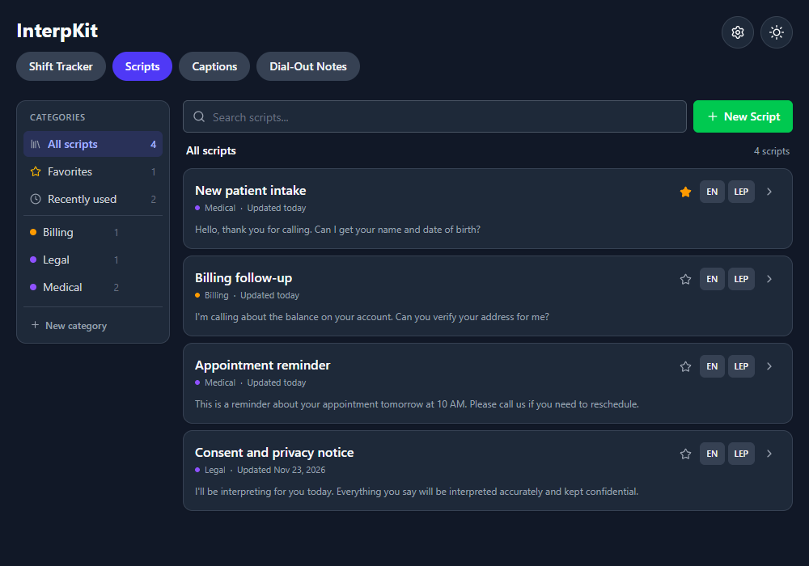
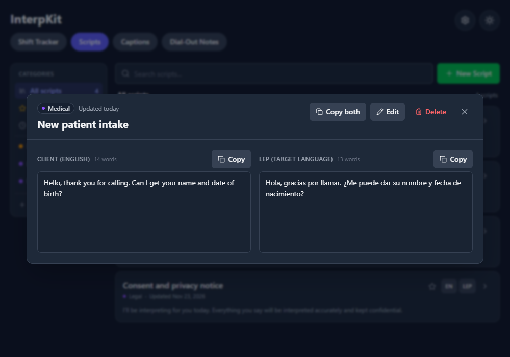
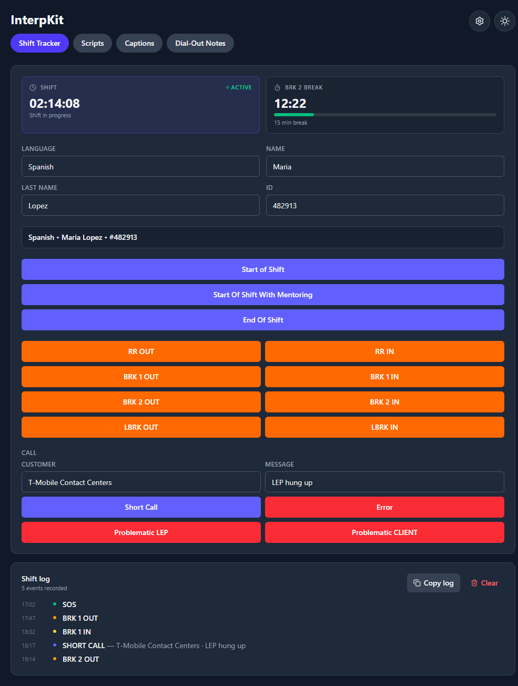
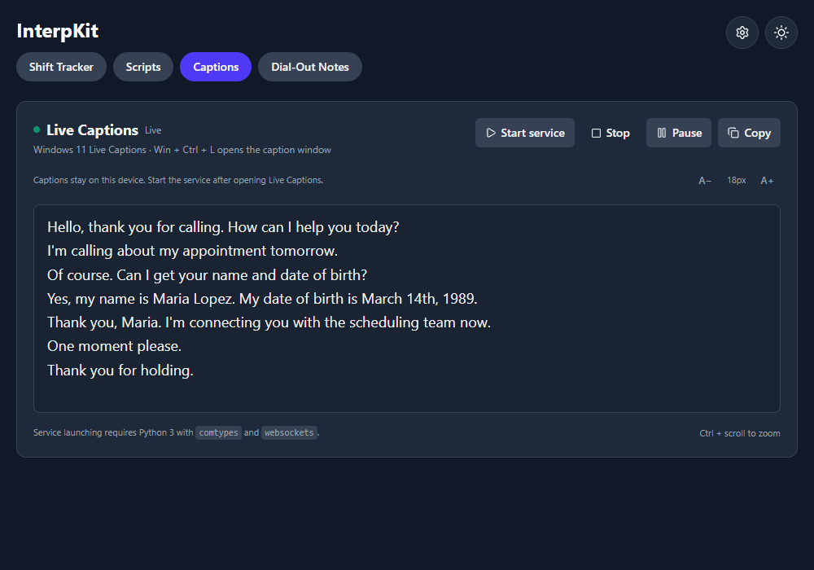
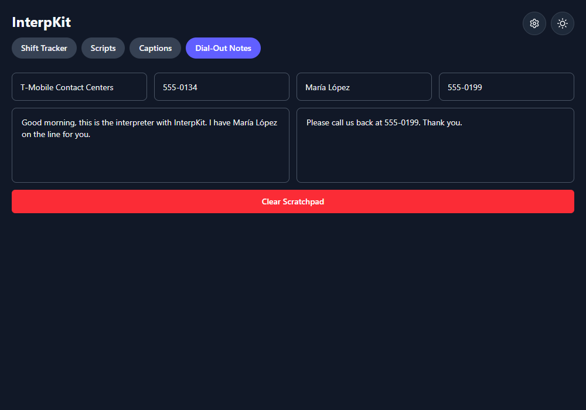
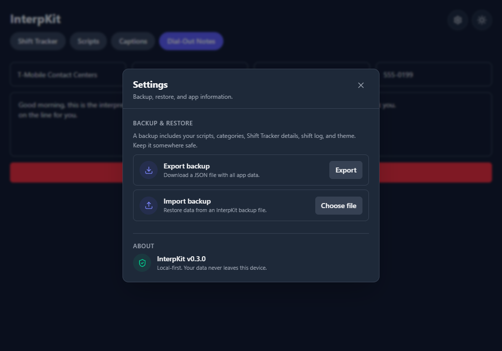

# InterpKit

A fast, offline desktop toolkit for interpreters. InterpKit keeps the things you reach for mid-call in one place: shift codes, saved English/LEP scripts, and a dial-out scratchpad.

Built with [Tauri 2](https://tauri.app/), [Preact](https://preactjs.com/), TypeScript, Vite, and Tailwind CSS.



## Features

### Shift Tracker

- Build a reusable call prefix from language, name, and ID.
- Copy formatted shift markers in one click: **Start of Shift**, **Start of Shift with Mentoring**, and **End of Shift**.
- Quick access to every break code (`RR`, `BRK 1`, `BRK 2`, `LBRK`).
- Log call outcomes as **Short Call**, **Error**, **Problematic LEP**, or **Problematic Client**, with customer and message details included.
- Track shift time and start a break countdown simply by copying a break code.
- Timestamp every shift, break, and call event in a shift log, then copy the whole log in one click.
- Your details are saved locally and restored automatically the next time you open the app.

### Scripts

- Save English and LEP versions of a script together as one entry.
- Organize scripts with categories, then filter the library by category.
- Search across titles, both languages, and category names.
- Pin favorites for quick access and jump to recently used scripts.
- Open a script in a focused modal with **English on the left and LEP on the right**.
- Copy either language, or both languages together, straight to the clipboard.
- Add, rename, and delete categories. Deleting a category moves its scripts to **Uncategorized** instead of deleting them.
- Create and edit scripts in a modal without leaving the library. Search and filters stay exactly where you left them.
- Existing single-script data from earlier versions is migrated automatically.

### Captions

- View **Windows 11 Live Captions** directly inside InterpKit.
- Start and stop the capture service from the app.
- Pause updates while selecting text, copy the transcript, and adjust the text size.
- Transcripts stay on your machine and are not saved.

Live Captions requires Windows 11 and Python 3 with:

```bash
pip install comtypes websockets
```

Open Windows Live Captions with **Win + Ctrl + L**, then click **Start service** on the Captions tab.

### Dial-Out Notes

- Keep client name, callback number, LEP name, and LEP number at hand.
- Capture the caller's intro and voicemail in side-by-side notes.
- Clear the scratchpad in one click.

### Throughout the app

- Export all app data to a JSON backup, or restore from a previous backup, in **Settings**.
- Dark and light themes with a persistent toggle.
- Everything runs locally. No accounts, no sync, no network calls.
- Escape closes modals, and focus stays inside them while open.

## Screenshots

| Script view | Shift Tracker |
| --- | --- |
|  |  |

| Live Captions | Dial-Out Notes |
| --- | --- |
|  |  |



## Download

Grab the latest Windows installer from the [Releases](https://github.com/mishamumladze/InterpKit/releases/latest) page.

Releases include both the NSIS installer (`*-setup.exe`) and the MSI package (`*.msi`), along with SHA-256 checksums. Builds for macOS and Linux can be produced from their respective platforms with `pnpm tauri build`.

Live Captions additionally requires Python 3 with `comtypes` and `websockets` installed. Everything else works without Python.

## Getting started

### Prerequisites

- [Node.js](https://nodejs.org/) 20 or newer
- [pnpm](https://pnpm.io/) 9 or newer
- [Rust](https://www.rust-lang.org/tools/install) (stable toolchain)
- Tauri's platform dependencies:
  - **Windows:** Microsoft C++ Build Tools and WebView2 (WebView2 ships with current Windows versions)
  - **macOS:** Xcode Command Line Tools
  - **Linux:** the WebKitGTK packages listed in the [Tauri prerequisites](https://tauri.app/start/prerequisites/)

### Install

```bash
pnpm install
```

### Run in development

```bash
pnpm tauri dev
```

For a browser-only preview without the Tauri shell:

```bash
pnpm dev
```

### Build a release

```bash
pnpm tauri build
```

Installers are written to:

- **Windows:** `src-tauri/target/release/bundle/nsis/` and `src-tauri/target/release/bundle/msi/`
- **macOS:** `src-tauri/target/release/bundle/dmg/`
- **Linux:** `src-tauri/target/release/bundle/deb/` and `src-tauri/target/release/bundle/appimage/`

## Project structure

```text
captions/           Python service that reads the Windows Live Captions window
src/
  pages/           Shift Tracker, Scripts, Captions, and Dial-Out Notes
  components/ui/   Shared UI primitives (Button, Input, Modal, ...)
  lib/             Clipboard, storage, backup, and shift-session helpers
src-tauri/         Tauri shell, configuration, and Rust entry points
docs/screenshots/  Images used in this README
```

## Data and privacy

InterpKit stores its data in the app's local browser storage:

- `interpkit.scripts.v2` — saved scripts, categories, favorites, and recent-use timestamps
- `interpkit.shift-tracker.v1` — Shift Tracker inputs
- `interpkit.shift-session.v1` — active shift, break timer, and shift log
- `interpkit.theme` — selected light/dark theme
- `interpkit.script.english` / `interpkit.script.lep` — legacy keys, read once and migrated into the script library

Shift Tracker details and the shift log are persisted locally. **Settings → Export backup** writes everything to a JSON file you can keep or move to another machine. Dial-Out Notes is an in-memory scratchpad and is not persisted.

Live Captions are read locally from Windows Live Captions by the capture service. The transcript is displayed in memory only — it is never saved, synced, or sent anywhere. Nothing leaves your machine.
